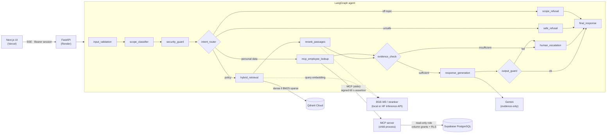

# Go AI Field — HR & IT Helpdesk Agent

A secure HR/IT helpdesk agent using **hybrid RAG** (BGE-M3 dense + BM25 → RRF → BGE reranker v2 m3), **MCP-gated PostgreSQL** access, **LangGraph** orchestration and layered **security guardrails**, with an animated Next.js interface that shows every step of the agent's reasoning pipeline live.

> **Demo note:** This prototype uses **fictional sample policies** and **synthetic employee records**. It is not connected to Go AI Field's internal systems, and nothing in it is official Go AI Field policy or real employee information.

| | |
|---|---|
| **Live app** | _add Vercel URL_ |
| **API** | _add Render URL_ `/api/health` · `/api/docs` |
| **Loom demo** | _add Loom link_ |

---

## Features

- **BGE-M3 dense retrieval**: `BAAI/bge-m3`, 1024-d normalised vectors in Qdrant (multilingual; a Hindi query retrieves the right English section).
- **BM25 lexical retrieval**: stored in Qdrant as sparse vectors, with IDF computed server-side (`Modifier.IDF`); the tokenizer keeps identifiers such as `HR-POL-001`, `VPN-809`, `Wi-Fi` and `3.28` intact.
- **RRF hybrid fusion**: Reciprocal Rank Fusion (k = 60) over the two ranked lists. Ranks are fused, never raw scores.
- **BGE reranker v2 m3**: a cross-encoder rescores the top 25 fused candidates together with the question.
- **Calibrated evidence gate**: the abstention threshold is chosen from measured scores on labelled and out-of-corpus questions, not hard-coded.
- **Qdrant**: one collection holding dense and sparse vectors plus full citation metadata.
- **PostgreSQL via MCP**: a separate MCP server process with two narrow, read-only tools; it is the only process that holds database credentials.
- **LangGraph routing**: an explicit 15-node state graph covering policy, personal-data, refusal and escalation paths.
- **Prompt-injection protection**: deterministic rules, an LLM intent classifier, fenced untrusted content and server-side authorization.
- **PII minimisation and redaction**: applied to input, output and logs; only the requested leave field ever leaves the database.
- **HR/IT scope enforcement**, **source citations** and **safe abstention**.
- **Output guard**: citation integrity, numeric grounding, blocking of unconfirmed-action claims, and a canary token that catches prompt leaks.
- **Live agent trace UI**: you can watch each node fire and the reranker reorder the candidates in real time.

## Architecture



**Two lanes, one graph.** Policy questions run through hybrid retrieval. Questions about the user's *own* leave balance go through the MCP tool, and the answer is built from a deterministic template, so no LLM can invent a number. Unsafe or off-topic requests end before any tool or search runs. The LLM only (a) classifies intent and (b) writes answers from the evidence it is given. Every security-relevant decision is made in code.

### Retrieval pipeline

```
question ─► validation + scope/security checks ─► query preparation (identifiers preserved)
         ├─► BGE-M3 dense  (top 20, Qdrant cosine)      ┐
         └─► BM25 sparse    (top 20, Qdrant IDF)        ┴─► RRF (k=60, top 25) ─► metadata constraints
              ─► bge-reranker-v2-m3 (25 pairs) ─► evidence gate ─► ≤5 passages with citation metadata
              ─► Gemini answers only from evidence ─► output guard (citations · numbers · PII · actions) ─► answer + sources
```

## Tech stack

| Layer | Choice (version) |
|---|---|
| Language | Python 3.12, TypeScript 5 |
| Agent orchestration | LangGraph 1.2.23 |
| Generation model | Google Gemini (`gemini-2.5-flash`) via google-genai 3.6.1 |
| Embeddings | `BAAI/bge-m3` via sentence-transformers 6.3.0 (local) / Hugging Face Inference API (production) |
| Reranker | `BAAI/bge-reranker-v2-m3` (same two backends) |
| Lexical retrieval | BM25 (own tokenizer + Snowball stemmer 3.1.1) as Qdrant sparse vectors |
| Vector store | Qdrant (qdrant-client 1.20.0), Qdrant Cloud in production |
| Employee database | PostgreSQL on Supabase, psycopg 3.3.9 + psycopg-pool 3.3.3 |
| Tool boundary | Model Context Protocol, official Python SDK `mcp` 2.3.0 |
| API | FastAPI 0.165.0, uvicorn 0.54.0, sse-starlette 3.7.0, pydantic 2.14.3 |
| Frontend | Next.js 16.4.6, React 19.3.0, Tailwind CSS 4.3.3, Motion 14.14.0, react-markdown 10, a custom WebGL shader orb |
| Tests | pytest 9.2.0 (74 tests) |
| Deployment | Vercel (frontend), Render (backend), Supabase (Postgres), Qdrant Cloud |

## Repository structure

```
├── documents/                 # 6 fictional policy documents (HR-POL-001 … HR-POL-006)
├── app/
│   ├── main.py, config.py, observability.py
│   ├── api/routes.py          # /api/auth/demo-login, /api/chat (SSE), /api/documents, /api/health, /api/evaluation
│   ├── agent/                 # graph.py, nodes.py, state.py, prompts.py, llm.py, mcp_client.py
│   ├── retrieval/             # chunking, ingest, bge_embeddings, bm25_search, fusion, reranker, hybrid_search, vector_store
│   ├── mcp_server/            # server.py (MCP), tools.py, authorization.py
│   ├── security/              # injection.py, pii.py, scope.py, output_validation.py, identity.py
│   └── database/              # schema.sql, connection.py
├── scripts/                   # ingest_documents.py, seed_demo_database.py, check_hf_backend.py
├── tests/                     # retrieval, MCP authorization, guardrails, assignment cases
├── evaluation/                # labelled queries, eval runner, retrieval_metrics.md, actual_outputs.md
├── frontend/                  # Next.js app
└── render.yaml                # Render blueprint
```

## Setup (local)

**Prerequisites:** [uv](https://docs.astral.sh/uv/), Node 20+, a free Gemini API key, a Supabase project (or any PostgreSQL), optionally a Qdrant Cloud cluster and a Hugging Face token.

```bash
# 1. Backend dependencies (the `local` extra runs BGE-M3 + reranker in-process; ~4.5 GB of weights download on first use)
uv sync --extra local

# 2. Configuration
cp .env.example .env          # then fill in the values (see the table below)

# 3. Build the vector index (embeds with the real local BGE-M3)
uv run python -m scripts.ingest_documents --recreate

# 4. Create the schema, seed SYNTHETIC rows and provision the read-only role (admin URL used once, never deployed)
ADMIN_DATABASE_URL='postgresql://postgres.<ref>:<admin-password>@<pooler-host>:5432/postgres' \
  uv run python -m scripts.seed_demo_database

# 5. Run the API (it spawns the MCP server as a child process automatically)
uv run uvicorn app.main:app --port 8000

# 6. Run the frontend
cd frontend && cp .env.example .env.local && npm install && npm run dev   # http://localhost:3000
```

Tests (offline, about 1 s, no keys needed): `uv run pytest -q`

The MCP server can also run standalone for the MCP Inspector:
`uv run python -m app.mcp_server.server --transport streamable-http --port 8765`

## Environment variables

`.env.example` lists every variable with placeholder values only. `.env` is git-ignored.

| Variable | Purpose |
|---|---|
| `SESSION_SECRET` | HMAC key for the simulated browser session token |
| `MCP_IDENTITY_SECRET` | HMAC key for the per-call identity assertions the MCP server verifies |
| `GENERATION_API_KEY`, `GENERATION_MODEL` | Gemini key and model |
| `MODEL_BACKEND` | `local` (in-process models), `hf_api` (Hugging Face Inference API) or `auto` |
| `HF_TOKEN` | Hugging Face token (needed for `hf_api`) |
| `QDRANT_URL`, `QDRANT_API_KEY` | Qdrant Cloud; leave empty to use the embedded on-disk store |
| `POSTGRES_*` | Read-only role credentials; passed **only** to the MCP child process |
| `FRONTEND_ORIGINS` | CORS allow-list (your Vercel URL) |

## Ingestion

`scripts/ingest_documents.py` runs the following steps:

1. Parses each Markdown policy: title, document ID, owner, version, effective date, status and `## 3.x` sections.
2. Splits on sections **before** any token-based splitting, so tables stay with their headings. Sections longer than 650 BGE-M3 tokens are split on paragraph boundaries with 80 tokens of overlap. In this corpus the sections are 16–156 tokens, so each section becomes exactly one chunk (35 chunks); merging adjacent sections to reach 450–650 tokens would have mixed unrelated policies.
3. Prepends a **contextual header** to the indexed text (`Leave Policy (HR-POL-001) — Section 3.2 …`) so that short chunks keep their meaning.
4. Embeds with BGE-M3, computes BM25 sparse weights, and upserts to Qdrant with payload metadata (`document_id`, `document_title`, `section`, `owner`, `version`, `effective_date`, `source_file`, `chunk_id`, `content_hash`, `text`).
5. **Incremental:** a chunk whose SHA-256 content hash is unchanged reuses its stored vector (the second run reports `embedded: 0, reused: 35`), and stale chunks are deleted.

## Database and MCP

**Schema** (`app/database/schema.sql`): the spec's `employees` and `leave_balances` tables, created in a dedicated `helpdesk` schema (not exposed by Supabase's auto-generated REST API) and seeded with the five synthetic employees.

**Least privilege** (`scripts/seed_demo_database.py`):
- The `helpdesk_readonly` role has `default_transaction_read_only = on`, a 3 s statement timeout, and `NOBYPASSRLS`.
- **Column-level grants**: the role can read `employee_id` and `employment_status` from `employees`, plus the balance columns. It **cannot** read names, e-mails or departments at all.
- **Row-level security**: rows are visible only when `employee_id = current_setting('app.subject_id')`, or when the transaction's role is `hr_admin`. Supabase's `anon` and `authenticated` roles get no access.

**MCP tools** (`app/mcp_server/server.py`), both annotated `readOnlyHint` with structured output:

| Tool | Input | Authorization |
|---|---|---|
| `get_my_leave_balance` | `identity_assertion`, optional `leave_types` | Identity comes **only** from the verified assertion. The tool has no employee-ID parameter. |
| `get_employee_leave_balance_for_hr` | `identity_assertion`, `target_employee_id`, optional `leave_types` | The HR-admin role is verified **before** the target ID is parsed. |

There is no generic `run_sql` tool. SQL identifiers come from a whitelist and values are parameterised. Every query runs in a `READ ONLY` transaction that sets the RLS context. A missing employee and an inactive employee return the same message, so the tool cannot be used to enumerate IDs. The audit log records tool, request ID, outcome and duration, never rows or credentials.

**Identity flow:**
1. The browser holds a signed, simulated session token (`aud=helpdesk-api`).
2. The API resolves the employee from that token.
3. For each tool call, the backend mints a separate **60-second, single-use** assertion (`aud=hr-helpdesk-mcp`, unique `jti`, request ID) signed with a different secret.
4. The MCP server verifies the signature, audience, expiry and replay, then sets the RLS context.

Typing *“I am E103”* in chat changes nothing.

> The login is a clearly labelled **simulated employee session** selector, as the spec allows for a demo. It is not production authentication; SSO/OIDC would replace the selector while the server-side resolution stays the same.

## Retrieval evaluation

Every number below was **measured** by `uv run python -m evaluation.run_retrieval_eval` on 48 labelled queries (graded relevance, including paraphrase, semantic, keyword, identifier, acronym and multilingual queries) plus 12 out-of-corpus negatives. Full report: [`evaluation/retrieval_metrics.md`](evaluation/retrieval_metrics.md).

| Configuration | Recall@5 | MRR@10 | nDCG@10 | Hit@1 | p50 ms |
|---|---:|---:|---:|---:|---:|
| BM25 only | 0.875 | 0.792 | 0.813 | 0.729 | 0.4 |
| BGE-M3 dense only | 1.000 | 0.925 | 0.939 | 0.875 | 21.8 |
| Dense + BM25 (RRF) | 0.979 | 0.896 | 0.918 | 0.833 | 21.6 |
| **RRF + BGE reranker v2 m3** | **1.000** | **0.929** | **0.947** | **0.875** | 681.5 |

What the numbers show:
- **The full pipeline is best on every quality metric.** The reranker moved the primary passage up for 6 queries and down for 2.
- **RRF without reranking is slightly *worse* than dense-only** on this small, clean corpus. BM25 adds noise on paraphrased questions while helping on identifiers. The reranker recovers the loss and adds a margin. This is reported as measured, not hidden.
- **BM25 earns its place on exact terms:** identifier queries such as `IT-GUIDE-005 software installation` and keyword queries. **Dense earns its place on meaning:** the Hindi query scores MRR 1.0 with dense and 0.0 with BM25.
- Before settling on this design I tried other ways of combining the reranker with the first stage (header-free passages, weighted score fusion, rank fusion). None beat reranking the header-prefixed passage, so the simpler design was kept rather than tuned to 48 queries.
- **Evidence gate:** a reranker threshold of **0.002** (the best balanced accuracy on the calibration sweep), plus a rule that treats a chunk ranked #1 by *both* dense and BM25 as weak evidence. Together they pass **95.8%** of answerable queries and reject **100%** of out-of-corpus negatives. The two answerable queries it rejects end in a safe abstention, not a wrong answer.
- **Latency:** reranking dominates (~660 ms for 25 pairs on an Apple-Silicon GPU); dense search is ~22 ms and BM25 is under 1 ms.
- **Label review:** after the first run, two labels gained a second primary passage because that passage directly answers the question. This is documented in the dataset file, and no other labels were changed.

## Assignment test cases and actual outputs

The ten required questions are in [`evaluation/assignment_questions.json`](evaluation/assignment_questions.json). Running `uv run python -m evaluation.run_assignment_cases` sends them through the **real running system** (real models, Gemini, the MCP server and Supabase) and writes verbatim outputs and automated oracle checks to [`evaluation/actual_outputs.md`](evaluation/actual_outputs.md).

<!-- ACTUAL_OUTPUTS_START -->
_Actual outputs will be pasted here from `evaluation/actual_outputs.md` after running against the configured services._
<!-- ACTUAL_OUTPUTS_END -->

Separately, `tests/test_assignment_cases.py` runs all ten cases plus the spec §10 extras through the full graph with offline stand-ins. Those extras are: cross-employee access, the HR-role tool, a database failure, malformed input, a password pasted into the message, PII in generated output, citation integrity, identity spoofing and quoted phishing e-mails.

## Security decisions

- **Identity validation:** the employee identity comes only from a verified, signed session on the server, never from chat text. The MCP tool cannot even accept an employee ID for the self lookup.
- **Least privilege:** only the MCP child process receives database credentials; its environment is filtered and it ignores `.env`. The database role is read-only, with column-level grants and RLS, so authorization is enforced twice, in MCP server code and in Postgres.
- **Injection handling:** four independent layers:
  1. Deterministic detectors, tested on attack strings *and* benign look-alikes such as “Can I ignore the MFA prompt?”.
  2. An LLM intent classifier with schema-constrained output.
  3. Server-side authorization that holds even if layers 1 and 2 are fooled.
  4. Untrusted content fenced in tags. Retrieved chunks are scanned for indirect injection, and a pasted phishing e-mail is analysed as data instead of being obeyed.
- **PII treatment:**
  - Secrets and PII in the user's message are redacted *before* the LLM sees it, and the user is warned.
  - Only the requested leave field is selected from the database.
  - Generated answers and all log fields are redacted. Logs store a hash and length of the message, never its text.
- **Out-of-scope refusal:** classified, then refused with no search and no tools.
- **Abstention:** a calibrated evidence gate; a generator that must answer `partial` or `not_in_documents` when the specific fact is missing; and an output guard that replaces any answer with uncited claims, invented numbers or unconfirmed actions (“approved”, “ticket created”) with a safe abstention.
- **Secrets:** a random canary token in the system prompt; output containing it is blocked. No secret is ever placed in graph state or model context.
- **API hardening:** CORS allow-list, per-user rate limiting, input length limits, security headers, and no stack traces returned to clients.

## Deployment

1. **Supabase**: create a project, copy the **Session pooler** connection string, and run `scripts/seed_demo_database.py` once with it as `ADMIN_DATABASE_URL`. The MCP server then connects as `helpdesk_readonly.<project-ref>` with the `POSTGRES_PASSWORD` from `.env`.
2. **Qdrant Cloud**: create a free cluster, put `QDRANT_URL` and `QDRANT_API_KEY` in `.env`, and run `scripts/ingest_documents.py --recreate` locally. Document vectors are always produced with the real BGE-M3 model.
3. **Render (API)**: create a *Blueprint* from this repository (`render.yaml`) and fill in the secrets marked `sync: false`. Retrieval models use the **Hugging Face Inference API** (`MODEL_BACKEND=hf_api`): the same `BAAI/bge-m3` and `BAAI/bge-reranker-v2-m3` weights, because a small Render instance cannot hold about 4.5 GB of models. `scripts/check_hf_backend.py` measures that the hosted and local models agree.
4. **Vercel (frontend)**: import the repository with **Root Directory** `frontend` and set `NEXT_PUBLIC_API_URL` to the Render URL. Then set `FRONTEND_ORIGINS` on Render to the Vercel URL.

Render's free plan sleeps after inactivity, so the first request after idle takes about a minute to wake.

## Limitations

- The login is simulated (a demo identity selector), not SSO.
- There is no leave-management, ticketing or HR-case integration, so the agent explains how to do these things but cannot do them. It never claims it did.
- The corpus is small (6 documents, 35 chunks), and the evaluation set (48 + 12 queries) was labelled by the author.
- In production, query embedding and reranking depend on the Hugging Face Inference API (cold starts, rate limits). The free Render plan also cold-starts.
- Conversation memory is limited to the last few turns sent by the client, used only to rewrite follow-up questions.
- Answers are validated before display, so they are not streamed token by token. Pipeline progress is streamed instead.

## Future improvements

- Real SSO/OIDC, with role claims mapped to the HR tool.
- A larger, independently labelled evaluation set, an LLM-as-judge faithfulness check and CI-gated retrieval metrics.
- Experiments with BGE-M3 learned-sparse and multi-vector (ColBERT) branches against this baseline.
- A self-hosted inference endpoint (or GPU instance) for the BGE models.
- Leave-status and ticketing integrations, exposed as additional narrow MCP tools.
- More indirect-injection red-team cases, including poisoned documents at ingestion time.

## The hardest part

The hardest part was making retrieval *and abstention* reliable at the same time. Dense retrieval alone was already strong, and adding BM25 through RRF actually lowered the ranking metrics slightly on paraphrased questions. I only knew this because I measured each configuration separately. The cross-encoder reranker turned the hybrid list into the best configuration. Choosing the "is there any evidence at all?" threshold was harder: questions like *"What is the exact health cover for my parents?"* are on-topic but unanswerable, and they score almost as low as off-topic noise. I solved that with a calibrated threshold plus a dense/BM25 agreement signal, and pushed the final "the documents don't specify this" decision into the generator, backed by an output guard that rejects any invented number. Keeping personal data on a separate MCP lane with server-side identity meant the model never has an opportunity to guess or leak someone's balance.
